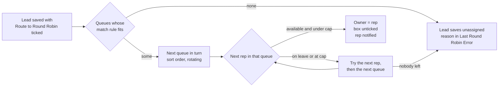

# Salesforce Lead Round Robin

Assigns new leads to sales reps in turn, across one or more queues, without ever losing a lead.

Tick **Route to Round Robin** on a lead (or have a form, import, integration or Flow tick it) and the lead goes to the next rep in line. Reps on leave are skipped, busy reps can be capped, senior reps can take more turns, and each queue can accept only the leads that match it (for example `Country = India`). If nobody can take the lead, it still saves and the reason is written on the lead.

   

Tested on 17 Oct 2026 in a Developer Edition scratch org: 25 Apex tests (96% coverage), a production-style check-only deploy with `RunLocalTests`, a live end-to-end smoke test (6 of 6 scenarios through the Bulk API, REST API and Flow action endpoint, run twice), and Salesforce Code Analyzer with no severity 1 findings.

## How it decides



- **Queues take turns.** With queues A and B, leads go A, B, A, B. A lead that doesn't match A's rule goes to B even when it's A's turn.
- **Reps take turns within a queue,** in a fixed order. A rep with weight 2 gets two leads per turn.
- **Positions are remembered** between saves in one row per queue (`Round Robin Assignment State`), so a lead created tomorrow continues where today stopped.
- **Bulk-safe.** A 200-lead import is split exactly evenly (tested), in a fixed number of queries whatever the batch size.
- **Never blocks a save.** Every failure unticks the box and records why; routing errors roll back cleanly.

## Install

You need the [Salesforce CLI](https://developer.salesforce.com/tools/salesforcecli) and an org you can deploy to (try a sandbox first).

```bash
git clone https://github.com/shivanathd/SalesforceLeadRoundRobin.git
cd SalesforceLeadRoundRobin
sf org login web --alias my-sandbox
sf project deploy start --source-dir force-app --target-org my-sandbox --test-level RunLocalTests
```

`RunLocalTests` runs the included tests during the deploy; production deploys require it anyway.

## Set it up (10 minutes)

1. **Create or pick a Lead queue.** Setup > Queues. Add the reps as members and make sure *Lead* is a supported object. Note the queue's API name, e.g. `Sales_Team`.
2. **Point round robin at it.** Setup > Custom Metadata Types > Round Robin Queue Config > Manage Records > New.

   | Field | What to enter |
   |---|---|
   | Queue API Name | The queue API name, e.g. `Sales_Team`. Names, not IDs, so the same config works in sandbox and production. |
   | Is Active | Ticked |
   | Sort Order | 1 for the first queue, 2 for the next, and so on |
   | Match Field / Match Values | Optional. A Lead field API name and comma-separated values, e.g. `Country` and `India, IN`. Case-insensitive. Blank = every lead. |
   | Max Open Leads per Rep | Optional cap. Reps who own this many open leads (not converted, status not starting with "Closed") are skipped. |
   | Notify Assignee | Send the rep a bell and mobile notification on assignment. |

   An inactive *Example Sales Queue* record is included to copy from.
3. **Give people access.** Assign the **Round Robin Admin** permission set to whoever manages routing, and **Round Robin User** to anyone who ticks the box or runs the flow action.
4. **Check it.** Developer Console > Execute Anonymous:

   ```apex
   System.debug(RoundRobinSetupCheck.run());
   ```

   Assign yourself **Round Robin Admin** first: Execute Anonymous only sees fields your own permissions allow, so even a System Administrator gets "Field does not exist" without it.

   ```text
   Round robin setup check
   - Sales_Team (order 1): 4 active reps, 3 available; cap 25 open leads per rep
   - India_Desk (order 2): 2 active reps, 2 available; only leads where Country in (India, IN)
   OK: no problems found.
   ```

## Using it

| You want to | Do this |
|---|---|
| Route a new lead | Tick **Route to Round Robin** on create (web-to-lead hidden field, import column, integration, or a default in your form) |
| Re-route an existing lead | Tick it again. It unticks itself after every attempt, so ticking always triggers a fresh routing. |
| Route from automation | Flow action **Route Leads (Round Robin)**: pass Lead IDs, get back Routed, Owner ID, Queue and Error per lead |
| Take a rep out for leave | Untick **Round Robin Available** on their User record. They keep their place and resume when re-ticked. |
| Give a rep more leads | Set **Round Robin Weight** on their User (1 to 10). Weight 2 = two leads per turn. |
| Start the rotation over | Flow action **Reset Round Robin Rotation**, or `RoundRobinService.resetRotation();` (needs Round Robin Admin) |
| See what went wrong | Lead list view **Round Robin Errors**, or the **Last Round Robin Error** field |

Every routed lead records **Round Robin Queue**, **Round Robin Assignment DateTime**, **Round Robin Triggered By** and **Round Robin Source** (how the save happened: UI, API, Bulk API, batch, Flow and so on), so you can report on who got what and how.

## Troubleshooting

| Last Round Robin Error says | Fix |
|---|---|
| No active round robin queues are configured. | Activate at least one Round Robin Queue Config record. |
| No active queue with members matches this lead. | The lead's value isn't in any queue's Match Values, or the queue has no active members. Run the setup check. |
| No eligible rep: everyone in the matching queues is unavailable or at capacity. | Re-tick Round Robin Available on someone, raise the cap, or add reps. |
| Routing failed (...) | An unexpected error. Nothing was changed; the full stack trace is in the debug log. Re-tick to retry. |

## Limits worth knowing

- Members of a queue that are roles or public groups are ignored; add users directly.
- The capacity cap counts open leads with one aggregate query, which counts toward Salesforce's 50,000-row query limit. Fine for typical teams; very large orgs with tens of thousands of open leads per team should leave the cap blank.
- Rotation state rows are locked while routing, so two saves at the same moment wait for each other briefly instead of both picking the same rep.
- A lead converted before routing is ignored.

## Project layout

```
force-app/main/default/
  triggers/LeadRoundRobinTrigger            thin trigger: before = route, after = notify
  classes/RoundRobinService                 the routing engine
  classes/RoundRobinActions                 Flow action: Route Leads (Round Robin)
  classes/RoundRobinResetAction             Flow action: Reset Round Robin Rotation
  classes/RoundRobinSetupCheck              read-only health report
  classes/*Test, RoundRobinTestData         25 tests and fixtures
  objects/Round_Robin_Queue_Config__mdt     queue config (custom metadata)
  objects/Round_Robin_Assignment_State__c   rotation position per queue
  objects/Lead, objects/User                routing, availability and weight fields
  permissionsets/                           Round Robin Admin, Round Robin User
scripts/smoke-test.sh                       live end-to-end check for scratch orgs
manifest/package.xml                        everything, for change sets and manifest deploys
```

Design notes, decisions and diagrams: [docs/DESIGN.md](docs/DESIGN.md). Changes: [CHANGELOG.md](CHANGELOG.md).

## Running the tests yourself

```bash
sf org create scratch --edition developer --alias rr --duration-days 1 --target-dev-hub <your-dev-hub>
sf project deploy start --source-dir force-app --target-org rr
sf apex run test --target-org rr --test-level RunLocalTests --code-coverage --wait 20
scripts/smoke-test.sh rr          # live: real config, Bulk API, REST, Flow action; scratch/trial orgs only
sf org delete scratch --target-org rr --no-prompt
```

The smoke test creates a rep, two queues (`RR_Smoke_Sales`, `RR_Smoke_India`), two config records and leads, checks six scenarios, then deletes its leads. It refuses to run against anything but a scratch or trial org.

## License

MIT
