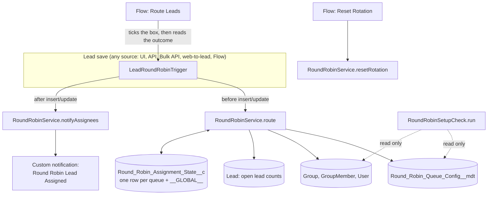

# Design

How the router works, and why it is built this way. For setup and day-to-day use, see the [README](../README.md).

## Components



## One routing pass

Every query runs once per save, not once per lead, so a 200-record batch costs the same number of queries as a single lead:

| Step | Query | Notes |
|---|---|---|
| Active configs | Custom metadata `getAll()` | No SOQL. Sorted by Sort Order, then queue name, so the order never depends on query order. |
| Members | `GroupMember WHERE Group.DeveloperName IN :names ORDER BY UserOrGroupId` | Config names queues, not IDs, so one config deploys to every org. Roles and groups inside a queue are ignored. |
| Reps | `User WHERE IsActive = true` | Reads Round Robin Available and Round Robin Weight. |
| Capacity | `Lead GROUP BY OwnerId` | Only for reps in queues that set a cap. |
| State | `Round_Robin_Assignment_State__c ... FOR UPDATE` | Locks the rows, so concurrent saves queue up instead of picking the same rep. |
| Save state | one `upsert` on `Queue_Key__c` | Only rows that changed. |

Planning happens in memory against those results. Lead fields are only written after the state upsert succeeds, so a failure leaves leads untouched.

## The rotation

Each queue's reps form a fixed list of *slots*, one per unit of weight, in user-Id order:

```text
queue Sales_Team, reps Asha (weight 2), Ben (1), Chen (1)
slots: [Asha, Asha, Ben, Chen]      Next_Index__c = position of the next slot
```

To place a lead:

1. Start at the global row's position in the queue list and walk forward to the first queue whose match rule accepts the lead and that has members.
2. In that queue, start at its `Next_Index__c` and walk forward to the first slot whose rep is available and under the cap.
3. Store the next position (always kept below the list size, so it never grows) and move the global position past this queue.
4. If no slot in that queue works, try the next matching queue. If none work, record the reason.

Unavailable reps are skipped at pick time rather than removed from the list, so they keep their place: when Asha comes back, the rotation hasn't shifted under everyone else.

## Decisions

| # | Decision | Why | Rejected |
|---|---|---|---|
| D5 | A failed routing saves the lead, unticks the box, records the reason | v1 used `addError`, which rejected the whole save and lost web-to-lead submissions | Blocking the save; leaving the box ticked (re-ticking a ticked box can't retry) |
| D6 | Config points at queues by API name | Queue IDs differ per org; v1's placeholder IDs broke deployment outright | Storing IDs |
| D7 | One state row per queue plus a global row | v1 kept a JSON map in one record: 32 KB ceiling, unreadable, indices growing forever | Fixing the JSON singleton |
| D8 | Weight and availability live on User | Salesforce doesn't allow fields on queue membership; one place to edit | A per-queue mapping object |
| D9 | Unexpected errors roll back and are recorded, never block the save | A routing bug must not cost a lead; the failure is visible on the lead and in the log | Letting unknown exceptions fail the save |
| D10 | One notification per lead, one summary per rep for bulk saves | Imports would flood reps and hit the hourly notification limit | Always one per lead |
| D11 | Removed the 20 v1 analysis documents | They described code that never compiled and claimed results that were never measured | Archiving them in the repo |

## Why the service runs without sharing

Routing is a system process. If it ran with the saving user's sharing and permissions:

- a Site guest or integration user without access to the routing fields would have their leads rejected (v1 did exactly this);
- a user who can't see the state rows would create a second set, silently forking the rotation (v1 could).

So `RoundRobinService` runs `without sharing` and skips CRUD/FLS checks, deliberately. The things a user can trigger directly are protected separately: the Route Leads flow action runs in user mode (you can only route leads and fields you can edit), and reset requires the `Round_Robin_Admin` custom permission.

## Partial-success saves

With `allOrNone=false` (Data Loader, many integrations), Salesforce rolls back a failed batch and re-runs the triggers for the records that can succeed, but static variables keep their values. The service keeps no static state between calls and reloads rotation state from the database each time, so the retry sees the rolled-back state and the counts only include leads that were actually saved. A test covers this.

## Failure map

| Where | What goes wrong | Handling | Lead shows |
|---|---|---|---|
| Configs | none active | every lead fails | No active round robin queues are configured. |
| Queues | API name not found, or no active users | queue skipped | (falls through to the next queue) |
| Match rule | field isn't on Lead | queue treated as not matching; setup check reports it | No active queue with members matches this lead. |
| Reps | all on leave or at cap | lead fails | No eligible rep: ... unavailable or at capacity. |
| State | row lock timeout, duplicate first-time row, any other exception | caught; nothing to undo, since the only write is one all-or-nothing upsert | Routing failed (ExceptionType): message |
| Limits | governor limit exceeded | cannot be caught by Apex | the save fails with the platform error |
| Notification | type missing or send fails | logged, ignored | nothing; the lead is already routed |

## Tests

25 tests in `RoundRobinServiceTest` and `RoundRobinActionsTest`, built on `RoundRobinTestData` (two queues, four Standard User reps, a public group inside one queue that routing must ignore). Custom metadata can't be inserted in tests, so configs are injected through `RoundRobinService.configOverride`.

They cover: single and 200-lead bulk inserts (exact even split), update routing and re-routing, inactive, unavailable and weighted reps, weight clamping, capacity caps, match rules, missing and inactive config, unknown queue names, rotation across saves, reset with and without permission, saves by a low-privilege user, partial-success inserts, forced failures rolling back, notifications, and both flow actions including a user without field access.

Beyond the unit tests, `scripts/smoke-test.sh` exercises the deployed package for real: custom metadata deployed as records, leads saved through the Bulk API and the REST API, and the Flow action called over its REST endpoint.

## Notifications and re-fired triggers

A workflow or process field update on Lead re-runs the after trigger with the original `Trigger.old`, so "assignment time changed" would be true twice. `RoundRobinService` remembers which leads it has notified in the current transaction and skips them the second time.
